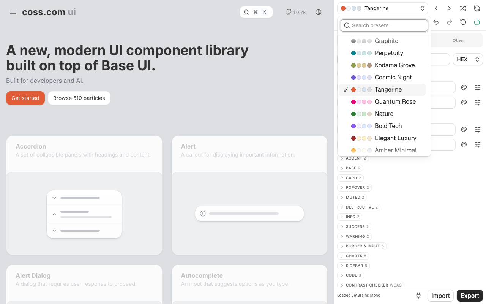

# Cossplay

Theme any [coss ui](https://coss.com/ui) site, live. Pick a preset or tune any token, and the page you are looking at changes as you go; export the result as Tailwind v4 CSS. It also works on sites that use shadcn-style theme variables.

**[Add to Chrome](https://chromewebstore.google.com/detail/odlgjkdboieignihoolihlebjhmjemlp)** · **[Open the web editor](https://cossplay.vercel.app/editor)** (nothing to install) · [cossplay.vercel.app](https://cossplay.vercel.app)



## Features

| Feature | Details |
|---|---|
| Detection | Reads variables on `:root`, `.dark`, `[data-theme]` and `@theme`; the browser resolves `var()`, `color-mix()` and `--alpha()` to concrete colors. The site bar shows whether variables were detected. |
| Tokens | coss `globals.css`: 41 colors (including info / success / warning / code), plus tweakcn's shared fields: `font-sans` / `font-serif` / `font-mono`, `radius`, `letter-spacing`, `spacing`, shadow color / opacity / blur / spread / offset. |
| Color editing | Grouped colors with search; HEX / OKLCH / HSL / RGB input, color picker, channel sliders, opacity and copy. Values are written back in the site's own color format. |
| Light / dark | Colors are edited per mode; shared fields edit both. Preview either mode on the page. |
| Presets | 42 tweakcn presets plus coss's default theme; reset to the preset or to the site's original theme. Presets only override the tokens they define. |
| Adjustments | Global HSL hue shift, saturation and lightness scale (15 presets), sidebar color sync. |
| Typography | Free-form font stacks with Google font search by category, explicit font loading (site CSP may block it), letter spacing. |
| Contrast | WCAG checks for 15 coss color pairs, with an issues-only view. |
| History | Undo / redo for every edit, ⌘Z / ⌘⇧Z. |
| Import | Registry or tweakcn URL, pasted CSS / JSON, or a CSS / JSON file. |
| Export | Tailwind v4 OKLCH CSS (coss `globals.css` shape), Tailwind v3 HSL CSS, registry JSON, light / dark token JSON, Tailwind v3 config, Next.js font layout; copy or download. |
| shadcn CLI | Every preset is a static shadcn registry item at `https://cossplay.vercel.app/r/themes/<preset>.json` (index: `registry.json`), generated by the web build. Export shows `shadcn add` for unedited presets (pnpm / npm / yarn / bun). |
| MCP | The plug button shows `components.json` and MCP config (Cursor, Windsurf, Claude Code, VS Code) for shadcn's MCP server with the `@cossplay` registry. |
| Inspect | Pick an element on the page to see which tokens it uses and edit them in place; Esc exits. |
| Web editor | The same panel at [cossplay.vercel.app/editor](https://cossplay.vercel.app/editor), previewing coss ui components, with nothing to install. |
| Per-site state | Saved per origin with an on/off switch; restored before first paint on reload. |

Only edited tokens are injected: untouched variables keep following the site, and component-scoped variables such as `[--radius:9999px]` are left alone. Shadows only change where the site's CSS reads the shadow variables; coss ui's own components compile their shadows to fixed values.

## Use it

- **Chrome extension:** install from the [Chrome Web Store](https://chromewebstore.google.com/detail/odlgjkdboieignihoolihlebjhmjemlp), open a coss ui site (for example `https://coss.com/ui`) and click the extension icon to open the side panel.
- **Web editor:** open [cossplay.vercel.app/editor](https://cossplay.vercel.app/editor).

## Build from source

```bash
pnpm install
pnpm build
```

Open `chrome://extensions`, enable Developer mode, choose **Load unpacked** and select `apps/extension/dist`. Visit a coss ui site (for example `https://coss.com/ui`) and click the extension icon to open the side panel.

For the Chrome Web Store package, listing text and images, see [`docs/store/listing.md`](docs/store/listing.md).

## Development

From the repository root:

- `pnpm dev`: CRXJS dev mode with HMR for the extension, plus the web dev server
- `pnpm build`: build the extension into `apps/extension/dist` and the website into `apps/web/dist/client`
- `pnpm check:type`: TSRS type checking across all five workspaces
- `pnpm format`, `pnpm lint`: Oxfmt and Oxlint (append `:fix` to fix)
- `pnpm lint:workspace`: Sherif workspace-integrity checks, separate from source linting
- `pnpm test`: core unit tests
- `pnpm test:e2e`: build, then run the Playwright tests

Use Node.js **22.12.0 or newer** and the pinned pnpm version. Pre-commit runs Oxlint fixes and Oxfmt on staged files. Existing CI format, lint and type-check steps call these root scripts. See [tooling and compatibility](docs/tooling.md) for versions, editor setup and migration limitations.

## Layout

pnpm + Turborepo monorepo:

- `apps/extension`: the MV3 extension (Vite + CRXJS): side panel host, content script, service worker
- `apps/web`: the website (TanStack Start, prerendered to static files in `dist/client`), deployed to Vercel from Git with Root Directory `apps/web`. `/` is the landing page; `/editor` is the browser theme editor, previewing coss ui particles installed from the `@coss` registry into `src/components`
- `packages/editor`: the panel (controls, dialogs, store) shared by the extension and the editor; each sets a `Host` for storage, fetching and fonts
- `packages/ui`: shadcn components, `cn`, `globals.css` (the extension panel) and `base.css` (component styles without theme values) for the panel
- `packages/core`: shared logic. `@cossplay/core/coss` holds tokens, site state and history, worker storage and the message protocol; `/coss/import` is the panel-only CSS / JSON importer
- `packages/core/scripts`: `sync:defaults` regenerates coss defaults from the coss registry style; `sync:tweakcn` regenerates tweakcn defaults, presets and HSL presets from a frozen tweakcn clone
- `tooling/typescript`: shared tsconfig

## Credits

Presets, defaults and the theme data shape come from [tweakcn](https://github.com/jnsahaj/tweakcn) (Apache-2.0, see `licenses/tweakcn.txt`). Not affiliated with coss, tweakcn or shadcn/ui.

## License

[Apache-2.0](LICENSE)
